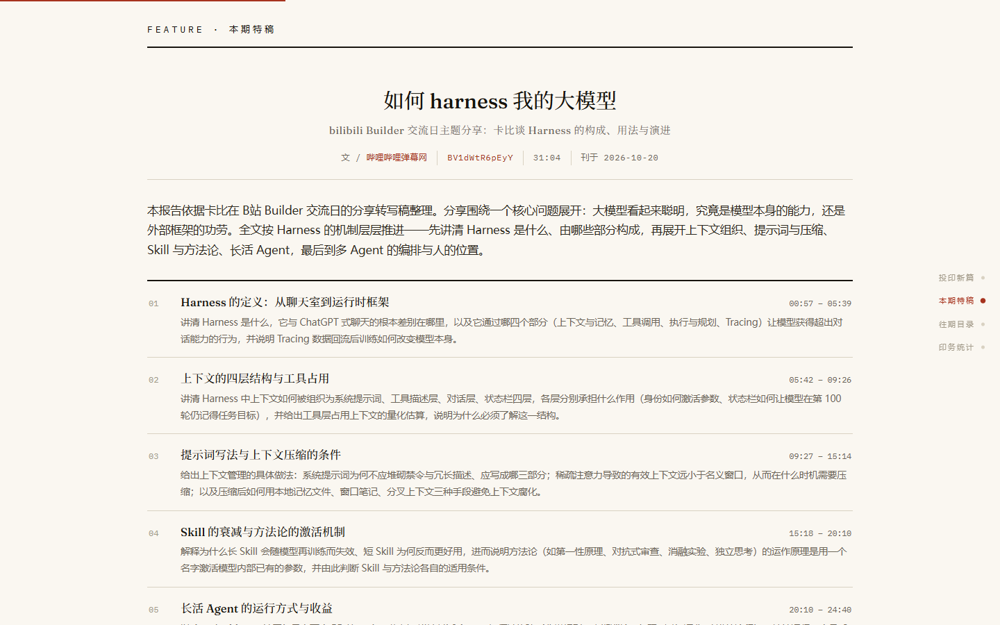
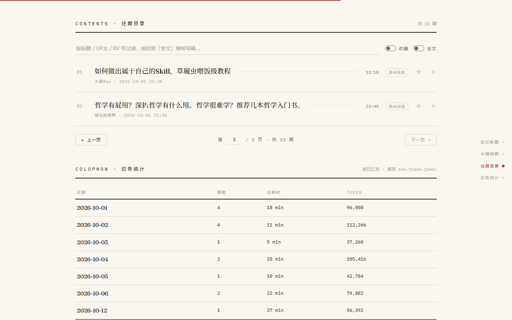
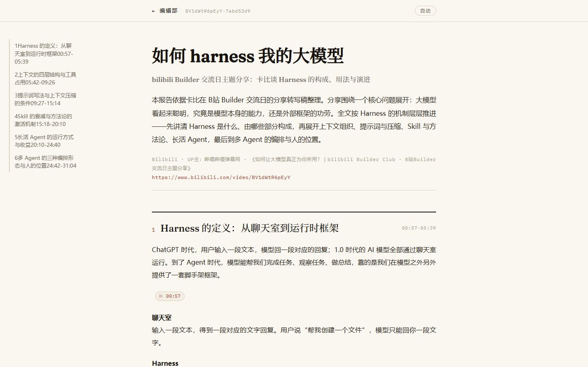

# videread

把 B 站视频 / 本地音视频的语音转写成结构化**自包含 HTML 阅读报告**：一条命令跑完下载、转写、结构规划、逐节写作与渲染，产出单个可以直接丢进浏览器的 `report.html`（无外链 CSS / 图片 / 字体）。

- **8 阶段流水线**：下载 → 音频处理 → 转写 → 规范化 → 结构规划 → 截图（可选）→ 逐节写作 → 渲染
- **断点续跑**：每个阶段的产物落盘即为缓存判据，中断后重跑不重复付费
- **可追溯**：正文段落通过 `data-source-units` 回指转写单元 id
- **可观测**：每次运行写出 `run.trace.jsonl`，逐阶段记录耗时与 token 用量

完整的接口契约、数据 schema 与验收标准见 [videread-开发文档.md](videread-开发文档.md)。

## 效果预览

| 编辑部首页（浅色） | 编辑部首页（深夜印刷间） |
|---|---|
|  |  |

---

## 快速开始

### 一键启动（Windows）

```
run.bat
```

双击或在命令行执行即可。脚本会依次自检四项：

| 步骤 | 行为 |
|---|---|
| Python | 依次尝试 `py -3` / `python`，缺失则提示安装 Python 3.11+ |
| 虚拟环境 | 无 `.venv` 时创建并 `pip install -e .`，已存在则跳过 |
| ffmpeg | 优先项目 `bin\`，其次系统 PATH；都没有则从 npmmirror 下载静态包解压到 `bin\` |
| 配置 | 无 `.env` 时从 `.env.example` 复制并提示填写密钥 |

无参数时默认启动本地 Web 服务并自动打开浏览器（见下方「Web 前端」）；带参数时原样透传给 CLI：

```
run.bat "https://www.bilibili.com/video/BV1xx411c7mD" --mode brief --open
```

### 手动安装

```powershell
py -3 -m venv .venv
.venv\Scripts\activate
pip install -e .
```

`src` 布局，未安装时也可用 `$env:PYTHONPATH="src"` 直接运行。

---

## 配置

复制 `.env.example` 为 `.env`（该文件不入库），按需填写：

| 变量 | 必填 | 说明 |
|---|---|---|
| `ASR_BACKEND` | 是 | `dashscope` / `dashscope-realtime` / `openai` / `local` |
| `DASHSCOPE_API_KEY` | 用 `dashscope*` 时 | 阿里云百炼（Model Studio）API Key |
| `DASHSCOPE_BASE_URL` | 否 | 默认 `https://dashscope.aliyuncs.com/api/v1`；私有化 MaaS 部署可覆盖 |
| `DASHSCOPE_MODEL` | 否 | 默认 `paraformer-v2`；实时后端未含 `realtime` 关键字时自动改用 `paraformer-realtime-v2` |
| `DASHSCOPE_LANGUAGE` | 否 | ASR 语言提示，默认 `zh`；设为 `auto` 时不传该参数、由服务端自动识别 |
| `ASR_MAX_CONCURRENCY` | 否 | 云 ASR 切段并发提交路数，默认 3；切段互相独立，加大可缩短总耗时，注意接口限流 |
| `ASR_REALTIME_SEGMENT_SECONDS` / `ASR_REALTIME_SPEEDUP` | 否 | 仅 `dashscope-realtime` 生效：单条连接推流切段上限（秒，默认 300）与推流倍速（默认 1.0，实测 4.0 稳定且收益见顶；小于 1 夹回 1.0） |
| `FRAMES` | 否 | 截图开关，默认 `0`；开启后按大纲章节定点抽取视频画面（720p 源、缩放宽 960）并以 base64 内嵌报告 |
| `LLM_BASE_URL` / `LLM_API_KEY` | 是 | 任意 OpenAI 兼容网关 |
| `LLM_MODEL_PLAN` / `LLM_MODEL_WRITE` | 否 | 结构规划与逐节写作所用的模型名 |
| `LLM_WRITE_CONCURRENCY` | 否 | 逐节写作并发路数，默认 3；各节互相独立，加大可缩短总耗时，注意接口限流 |
| `LLM_TIMEOUT` | 否 | 单次 LLM 调用超时秒数，默认 180 |
| `OPENAI_API_KEY` / `OPENAI_BASE_URL` / `OPENAI_ASR_MODEL` | 用 `openai` 后端时 | 未配置时回退复用 `LLM_*` |
| `LOCAL_ASR_MODEL` / `LOCAL_ASR_DEVICE` / `LOCAL_ASR_COMPUTE_TYPE` / `LOCAL_ASR_LANGUAGE` | 用 `local` 后端时 | 模型规格（tiny/base/small/medium/large-v3，默认 small）、设备（默认 auto）、计算精度（默认 auto）、语言提示（默认 auto） |
| `FFMPEG_BIN` / `FFPROBE_BIN` | 否 | 留空则按 `bin/` → PATH 顺序探测 |
| `PDF_BROWSER_BIN` | 否 | PDF / PNG 长图导出用的浏览器路径；留空自动探测 Edge / Chrome（Windows 10/11 自带 Edge，无需安装） |
| `YTDLP_COOKIES_FILE` / `YTDLP_COOKIES_FROM_BROWSER` | 否 | B 站登录信息，用于需要登录态的视频（如大会员专享；充电专属 / 付费课程不适用，见下方「B 站登录」）。登录态同时决定 B 站 AI 字幕是否可见，见下 |
| `SUBTITLE_FIRST` | 否 | 字幕优先，默认 `1`：平台字幕（含 AI 字幕）覆盖视频时长 ≥50% 时直接由字幕建稿，**跳过音频下载、音频处理与 ASR**；覆盖不足或无字幕自动回退 ASR。cookies 里缺 SESSDATA 导致没抓到字幕时，流水线会给出提示 |
| `REPORT_LANG` | 否 | 报告输出语言，默认 `zh`。支持 `en` / `ja`（未收录代码原样透传给模型）。语言只作用于结构规划、逐节写作与问答的自然语言产出，转写稿保持源语言；zh 之外按「词」计数篇幅。切换语言会自动重出大纲与正文（转写与 ASR 缓存仍有效） |
| `HTTP_PROXY` / `HTTPS_PROXY` | 否 | 同时作用于 `httpx` 与 `yt-dlp` |

优先级：`.env` → 环境变量 → CLI 参数（后者覆盖前者）。

### B 站登录（可选，用于需要登录态的视频）

部分视频需要 B 站登录态才能取得完整内容（例如大会员专享）。想让本工具解析它们：

1. 用**有观看权限**的 B 站账号登录浏览器；
2. 两种方式任选其一：
   - 在浏览器装「Get cookies.txt LOCALLY」一类插件，把 bilibili.com 的登录信息导出为 Netscape 格式的 `cookies.txt` 文件，然后在 `.env` 里填一行 `YTDLP_COOKIES_FILE=D:\路径\cookies.txt`；
   - 或者不导出文件，直接在 `.env` 里填 `YTDLP_COOKIES_FROM_BROWSER=edge`（也支持 `chrome` / `firefox`），工具会自己读取那个浏览器的登录信息；
3. 重启服务生效。

注意：**充电专属视频和付费课程暂不支持解析**——无论是否配置登录信息，预检都会直接拒绝并给出中文提示（见下方「约定与限制」）；普通视频不受影响。

登录态的另一个作用：**B 站 AI 生成字幕（ai-zh / ai-en）只对登录用户可见**。配置好含 SESSDATA 的 cookies 后，带 AI 字幕的视频（口播、知识类最常见）可以直接由字幕建稿——不下载音频、不调 ASR，几分钟的报告几十秒出。设备 cookie（buvid3 等）不算登录；cookies 里没有 SESSDATA 时，流水线在「下载」阶段会提示。导出方法同上，导出前确认浏览器已登录 B 站。

---

## 用法

```powershell
python -m videread.cli BV1xx411c7mD
```

> 注意入口是 `videread.cli`，项目没有 `__main__.py`，`python -m videread` 会报 `No module named videread.__main__`。
> 安装后也可直接使用 `videread` 命令（`pyproject.toml` 中的 console script）。

| 参数 | 默认 | 说明 |
|---|---|---|
| `url` | — | Bilibili 视频链接或 BV 号（如 `BV1xx411c7mD`）、本地音视频文件路径；也可以是一个 `.txt` 批量列表（每行一个来源，`#` 为注释，逐个顺序解析，失败不中断） |
| `--mode` | `standard` | `standard` 详细讲解 / `deep` 深度精读 / `brief` 快速概览 / `outline` 极简大纲（每节一句话要点，最快最省） |
| `--out` | 项目根 `runs/` | 产物根目录 |
| `--no-cache` | 关 | 忽略已有产物，全部重跑 |
| `--keep-audio` | 关 | 跑完保留音频中间文件（默认自动清理） |
| `--open` | 关 | 生成后用浏览器打开报告 |
| `--asr` | 取自 `.env` | 临时覆盖 ASR 后端 |
| `--force-asr` | 关 | 单次强制走 ASR 路径（忽略字幕优先），用于验证字幕与 ASR 的差异 |
| `--lang` | 取自 `.env` | 报告输出语言（`en` / `ja`，默认 zh）。转写稿保持源语言；切换语言自动重出大纲与正文 |
| `--frames` | 取自 `.env` | 按章节截取视频画面并内嵌进报告（每节 1 张、全片 16 张封顶） |
| `--pdf` | 关 | 报告生成后用本机 Edge / Chrome 无头打印导出 `report.pdf`（已存在且较新则复用） |
| `--png` | 关 | 报告生成后用本机 Edge / Chrome 无头截图导出竖长 `report.png`（宽 900，整页一图，适合直接分享） |
| `--md` | 关 | 报告生成后转换导出 `report.md`（纯文字层次，适合粘贴进笔记软件二次加工）。勾选截图的报告不提供 MD 导出，请改用 `--pdf` / `--png` |
| `--version` | — | 打印版本 |

### 退出码

| 码 | 含义 |
|---|---|
| 0 | 成功 |
| 1 | 参数 / 用法错误（含缺少密钥） |
| 2 | 下载失败（反爬、地区限制、链接失效） |
| 3 | 音频处理或 ASR 失败 |
| 4 | LLM 调用失败（超时、限流、JSON 非法且重试耗尽） |
| 5 | 渲染或写盘失败 |
| 130 | 任务被用户取消（已生成产物保留，可续跑） |

---

## Web 前端（编辑风）

不想敲命令时用本地 Web 服务：浏览器打开后会进入杂志编辑风的「编辑部」界面，包含投印新篇（提交 BV 号 / 本地文件，多P 可选，可选报告语言）、本期特稿（最新一期报告的完整排版与操作）、往期目录（全部报告：分页 / 关键词 / 收藏 / 全文检索 / 改名 / 删除 / 单份与批量导出）、印务统计（按日耗时与 token）四大板块；右上角「设置」可就地配置 LLM 网关与模型（存用户级配置，优先于 `.env`，免改文件重启）。投印提交后进入独立工单页，实时显示 8 阶段步进器与排印日志，可随时取消。

| 本期特稿 | 往期目录 |
|---|---|
|  |  |

报告点「翻开全文」进入阅读页——原 `report.html` 重排为杂志版式，支持章节直达与时间戳跳转原视频，并提供 MD / PDF 导出与编辑风 PNG 长图（无头浏览器整页截取阅读页版式，缓存在 run 目录）；「致编辑部来信」可就单篇报告提问，答案只依据转写稿作答。

| 阅读页（杂志版式） |
|---|
|  |

```powershell
run.bat                          # Windows 一键启动（无参数即起 Web 服务并开浏览器）
run.bat web                      # 同上，显式写法
python -m videread.web --open    # 等价的手动方式
videread-web                     # 安装后的服务命令
```

| 参数 | 默认 | 说明 |
|---|---|---|
| `--host` | `127.0.0.1` | 只绑本机；服务无鉴权，请勿改为对外地址 |
| `--port` | `8765` | 监听端口 |
| `--out` | 项目根 `runs/` | 产物根目录，与 CLI 的 `--out` 是同一个 |
| `--open` | 关 | 启动后用浏览器打开前端 |

约定与限制：

- **同一时刻只执行一个任务，其余排队**：提交时若已有任务在跑，新任务进入 FIFO 队列（上限 10 个，超出返回 409），前一个结束后自动开跑；串行既是个人工具的取舍，也避免争用同一 run 目录、重复付费。批量场景也可以直接用 CLI 的 `.txt` 列表。
- **支持取消**：工单页点「取消投印」，流水线在最近的检查点（阶段边界、ASR 切段之间、逐节写作各节之间）停止；排队中的任务直接出队。已落盘产物照常保留，重新提交同一视频即可从断点续跑，已完成的节不再重复付费。
- **主题**：报头开关在浅色 / 深色两档间直接切换，默认浅色；选择存浏览器 localStorage，换浏览器不迁移。深色为「深夜印刷间」配色（深纸底 / 暖白字 / 强调红提亮），主页、阅读页、工单页三页同步。
- **收藏报告**：目录行「☆」按报告（run）标记收藏，收藏开关只显示收藏项并按收藏先后排序；收藏存在产物根目录的 `.favorites.json`，删除报告时同步摘除，换 `--out` 则跟随该目录。
- **报告库分页**：往期目录每页 10 条（后端支持 5 / 10 / 20 / 50），关键词过滤 + 页码跳转，全部走服务端查询。
- **批量导出**：往期目录点「批量导出」进入勾选模式，可跨页勾选、全选本页；可选 Markdown / PDF / PNG，打包为 ZIP 一次下载。Markdown 与单份导出同规则——不含视频截图，带截图的报告在勾选阶段就不可选（切到 PDF / PNG 后恢复可选）；接口收到这类组合也会整批拒绝并点名，不会交出缺文件的压缩包。PDF / PNG 命中 run 目录里的缓存时直接打包，不重复调用浏览器。
- **报告内问答（致编辑部来信）**：就当前特稿提问，答案只依据该报告的转写稿作答；问答历史随 run 存于 `qa.jsonl`，再次打开可回放，每封来信可单独删除。
- **全文检索**：目录搜索框可切换全文模式，在所有报告的转写稿正文里搜关键词（≥2 个字），结果带命中摘要与次数。
- **统计**：印务统计按日汇总所有 run 的总耗时与 token 用量（读自各 run 的 `run.trace.jsonl`）。
- **重复解析不覆盖旧报告**：输入已解析过的视频，预检会标注「已解析过（时间）」；投印时若命中历史记录会先弹「这一期已经印过了」确认（可取消，可点「查看上次报告」直达旧报告）。确认后忽略缓存全量重跑落到 `-r2`、`-r3`…新目录，旧报告原样保留；删除报告后预检缓存作废。
- **投印参数策略固定**：不提供「忽略缓存 / 保留音频 / 转写引擎」的界面开关——提交即忽略缓存强制重跑、不保留音频文件、转写引擎按 `.env` 的 `ASR_BACKEND` 配置。
- **充电专属/付费视频/付费课程暂不支持解析**：这类内容未付费时 B 站只放出试看，解析没有意义。预检即识别（充电专属标志、付费稿件标志、课程集 playable 标志、时长比对）：前端会禁用「投递」按钮并提示暂不支持，流水线侧也一律拒绝兜底。付费课程（`bilibili.com/cheese/play/ep*`）同样覆盖，run-id 用 `ep{集号}` 前缀。
- **改 `.env` 后需重启服务**：`.env` 以 `override=False` 加载，已在进程里生效的键改值不会立刻刷新（新增的键可以）。

---

## 产物

输出到 `<out>/<视频标识>-<路径哈希>/`：

| 文件 | 说明 | 可否复用 |
|---|---|---|
| `meta.json` | 标题 / UP主 / 时长 / URL / 封面 | 是 |
| `audio.m4a` | 原始音频（仅在线视频；`--keep-audio` 时保留） | 是 |
| `audio.wav` | 16kHz 单声道，ASR 输入（跑完自动清理） | 可删 |
| `asr.raw.jsonl` | ASR 原始输出，带时间戳（长音频切段时为 `asr.part.NNN.<start>-<end>.jsonl`，文件名含切段边界，切段点变化后旧缓存自动失效） | **是（最贵，务必保留）** |
| `transcript.jsonl` | 规范化转写单元，带 `id` | 是 |
| `transcript.md` | 同上，人 / 模型可读 | 是 |
| `outline.json` | 结构规划结果 | 是 |
| `sections/sN.html` | 逐节正文片段 | 是 |
| `report.html` | 最终自包含报告 | 是（存在即跳过渲染） |
| `run.trace.jsonl` | 逐阶段耗时 / token 埋点 | — |

阶段 1 命中 `meta.json` 前会先校验其中的 `url` 与本次请求的规范 URL 是否一致，不一致即视为未命中，避免 run 目录被别的视频复用。

最终产出自包含的 `report.html`。在 Web 阅读页中的呈现如下——开启 `--frames` 的报告按章节内嵌视频画面，未开启则为纯文字排版：

| 开启 `--frames`（内嵌视频画面） | 纯文字报告 |
|---|---|
|  |  |

---

## ASR 后端

| 后端 | 通道 | 适用场景 |
|---|---|---|
| `dashscope` | 异步：`getPolicy` → OSS 直传 → 提交任务 → 轮询 | 账号对 `dashscope-instant` 即时桶有授权时，可并行切段 |
| `dashscope-realtime` | 实时：WebSocket 二进制帧直推 | 不经 OSS 桶，**不受对象归属校验限制**；长音频切段后多路并行推流（`ASR_MAX_CONCURRENCY` × `ASR_REALTIME_SPEEDUP` 倍速） |
| `openai` | OpenAI 兼容 `audio/transcriptions` | 自备 whisper 类服务 |
| `local` | 本地 faster-whisper（CTranslate2） | **离线、免费**；可选依赖（`pip install -e ".[local]"`），首次运行下载模型（国内可设 `HF_ENDPOINT=https://hf-mirror.com` 走镜像），速度取决于机器性能 |

若异步后端报 `403 Resource.AccessDenied`（提示 `OSS Resource oss://dashscope-instant/... access denied`），属账号对即时桶无读取授权，换 Key 不解决，改用 `dashscope-realtime` 即可。

---

## 目录结构

```
videread/
├─ run.bat                    # 一键启动（无参数起 Web 前端；带参数透传 CLI）
├─ .env / .env.example        # 密钥 / 模板
├─ bin/                       # ffmpeg.exe / ffprobe.exe（可选）
├─ src/videread/
│  ├─ cli.py                  # 参数解析、进度输出、退出码
│  ├─ pipeline.py             # 8 阶段编排、断点续跑
│  ├─ config.py               # 配置分层与外部程序探测
│  ├─ download.py audio.py transcript.py
│  ├─ execution.py failures.py  # 外部命令统一执行 / 退出码归类文案
│  ├─ asr/                    # dashscope / realtime / openai_whisper
│  ├─ report/                 # outline / writer / prompts
│  ├─ render.py trace.py      # 模板填充与埋点
│  ├─ web/                    # 本地 Web 服务（FastAPI；static/editorial/ 编辑风前端）
│  └─ templates/              # standard/deep 共用 + brief + outline 三套模板
├─ runs/                      # 运行产物（不入库）
└─ tests/                     # 离线用例
```

---

## 测试

```powershell
pytest -q
```

340 条用例全部离线，不联网、不调用 ffmpeg 与 LLM。`pyproject.toml` 预留了 `network` marker，并默认 `-m 'not network'`，后续加入联网集成测试时会自动被排除。

---

## 常见问题

**提示找不到 ffmpeg** — 把 `ffmpeg.exe` / `ffprobe.exe` 放进项目 `bin\`，或 `winget install Gyan.FFmpeg`，或在 `.env` 里用 `FFMPEG_BIN` / `FFPROBE_BIN` 指定绝对路径。

**控制台中文乱码** — CLI 已在启动时把 stdout/stderr 重配为 UTF-8；用 `run.bat` 时脚本会先执行 `chcp 65001`。

**转写结果为空** — 该音频区间确实没检测到人声（例如音乐视频的长片头），不是接口故障。

**想换一个视频重跑** — 直接换 URL 即可，会落到新的 run 目录；同一视频想强制刷新则加 `--no-cache`。